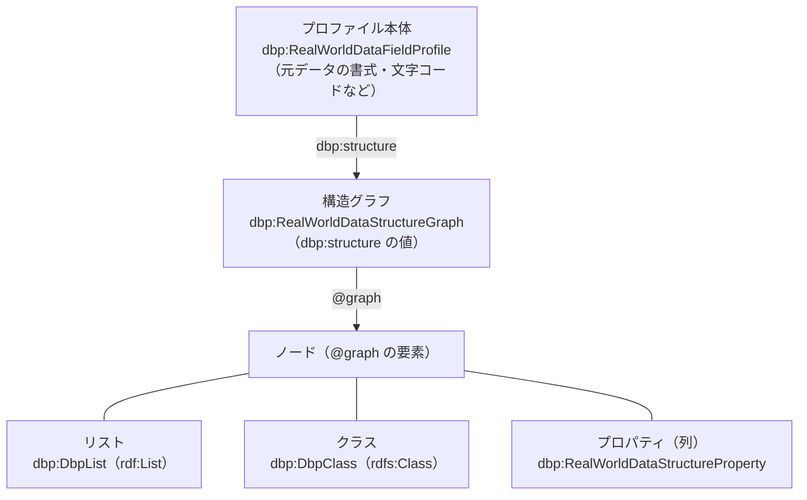

<!--
  この文書の各プロパティの見出し（<a id="…">）は、他の repo（dbp-dbpa-compressor の docs/structure-info-spec.md など）
  からリンクされています。id を変えるときは、リンク元も一緒に直してください。
  id の付け方: キー名を小文字にし、`:` を `-` に、先頭の `@` を `at-` に置き換える。
  例: dbp:itemType → dbp-itemtype / schema:rangeIncludes → schema-rangeincludes / @graph → at-graph
-->

# RWD Profile のプロパティ一覧

RWD Profile（Real World Data Profile）は、実世界データの **構造と書式** を JSON-LD で表したものです。
この文書は、その語彙（`dbp:RealWorldDataFieldProfile` とその中身）の **各プロパティが何を意味するか** をまとめた説明書です。

- 語彙の定義の元は [dbp_schema.proto](../dbp_schema.proto)（日本語コメント版は [dbp_schema.ja.proto](../dbp_schema.ja.proto)）です。[dbp-schema.jsonld](../dbp-schema.jsonld) はそこから生成されます。
- この文書が書くのは **プロパティの意味・型・付く場所** です。「どの条件でその値を出力するか」「値をどう計算するか」は **利用するプログラム側の説明** に任せます。
  - 例: SemantiPack（[dbp-dbpa-compressor](https://github.com/exdata-inc/dbp-dbpa-compressor)）での扱いは、同 repo の `docs/structure-info-spec.md` にあります。
- 語彙は制約言語（SHACL など）を持ちません。「必須」「この値のときだけ」といった決まりは、語彙では表現していません。

## 目次

1. [全体の形](#1-全体の形)
2. [プロファイル本体 `dbp:RealWorldDataFieldProfile`](#2-プロファイル本体-dbprealworlddatafieldprofile)
3. [構造グラフ `dbp:RealWorldDataStructureGraph`](#3-構造グラフ-dbprealworlddatastructuregraph)
4. [グラフのノード](#4-グラフのノード)
   - [4.1 ノードをつなぐ `schema:rangeIncludes` / `schema:domainIncludes`](#41-ノードをつなぐ-schemarangeincludes--schemadomainincludes)
   - [4.2 リスト `dbp:DbpList`](#42-リスト-dbpdbplist)
   - [4.3 クラス `dbp:DbpClass`](#43-クラス-dbpdbpclass)
5. [プロパティ（列）`dbp:RealWorldDataStructureProperty`](#5-プロパティ列dbprealworlddatastructureproperty)
   - [5.1 基本](#51-基本) / [5.2 圧縮のメタ情報](#52-圧縮のメタ情報) / [5.3 型](#53-型) / [5.4 単位と尺度](#54-単位と尺度) / [5.5 値の特徴](#55-値の特徴) / [5.6 日時](#56-日時) / [5.7 数値の範囲と精度](#57-数値の範囲と精度) / [5.8 サンプルと列挙値](#58-サンプルと列挙値) / [5.9 データフィールドカタログ](#59-データフィールドカタログ)
6. [値の一覧（enum）](#6-値の一覧enum)
7. [表記のゆれと、語彙の外にある使われ方](#7-表記のゆれと語彙の外にある使われ方)

---

## 1. 全体の形

RWD Profile は、3 つの層でできています。



| 層 | 何を表すか | 説明の節 |
|---|---|---|
| プロファイル本体 | 元ファイル全体の書式（形式・改行・文字コード・CSV の区切りなど） | [2 章](#2-プロファイル本体-dbprealworlddatafieldprofile) |
| 構造グラフ | データの入れ子の形。ノードを平らな配列（`@graph`）で持つ | [3 章](#3-構造グラフ-dbprealworlddatastructuregraph) |
| ノード | リスト（配列）・クラス（オブジェクト）・プロパティ（名前の付いた値） | [4 章](#4-グラフのノード)・[5 章](#5-プロパティ列dbprealworlddatastructureproperty) |

README の [RWD Profile Example](../README.md#rwd-profile-example) に、CSV と JSON の具体例があります。

### 表の読み方

- 「型」は、語彙（`.proto`）上の型です。`string` `integer` `bool` `float` のほか、他のクラスを指すものはクラス名で書きます。
- 「複数」は、同じキーに値を複数持てる（配列で書ける）ことを表します。
- 数値の範囲（`rangeMin` など）は、数値でも **string** で持つ決まりです。

---

## 2. プロファイル本体 `dbp:RealWorldDataFieldProfile`

元データ 1 件ぶんの「書式」と「構造への入り口」をまとめたオブジェクトです。
`dbp:RealWorldDataset` の `dbp:structureInfo` が、このクラスを指します。

### JSON-LD の基本

| キー | 型 | 意味 |
|---|---|---|
| <a id="at-id"></a>`@id` | string | プロファイルの識別子（JSON-LD の `@id`）。ノードでは、`@graph` の中で他のノードから参照するための名前になります |
| <a id="at-type"></a>`@type` | string | 何のオブジェクトか。プロファイル本体は `dbp:RealWorldDataFieldProfile` |
| <a id="at-context"></a>`@context` | object | JSON-LD の名前空間の対応表（`dbp` `rdf` `rdfs` `schema` など） |
| <a id="schema-name"></a>`schema:name` | string | 名前（schema.org の `name`） |
| <a id="schema-url"></a>`schema:url` | string | URL（schema.org の `url`） |

### 構造への入り口

| キー | 型 | 意味 |
|---|---|---|
| <a id="dbp-structure"></a>`dbp:structure` | `RealWorldDataStructureGraph` | データの入れ子の形（[3 章](#3-構造グラフ-dbprealworlddatastructuregraph)）。`@graph` を含む JSON-LD |

### 元データの書式

元ファイルを **同じ形に戻す** ために必要な情報です。

| キー | 型 | 意味 |
|---|---|---|
| <a id="schema-encodingformat"></a>`schema:encodingFormat` | string | 元ファイルの MIME タイプ（schema.org の `encodingFormat`） |
| <a id="dbp-newlinecharacter"></a>`dbp:newLineCharacter` | string | ファイル中の改行コード。値の集合は語彙では決めていません |
| <a id="dbp-textencoding"></a>`dbp:textEncoding` | string | ファイル中の文字コード |

### 作成・圧縮したプログラムの情報

| キー | 型 | 意味 |
|---|---|---|
| <a id="dbp-rwdprofilegeneratorversion"></a>`dbp:rwdProfileGeneratorVersion` | string | このプロファイル（メタデータ）を作ったときの SemantiPack のバージョン |
| <a id="dbp-semantipackversion"></a>`dbp:semantiPackVersion` | string | 圧縮したときの SemantiPack のバージョン。生成と圧縮でバージョンが違うことがあるため、別のキーになっています |
| <a id="schema-datecreated"></a>`schema:dateCreated` | string | 構造情報を作った日時（schema.org の `dateCreated`） |

### JSON 形式のデータの書式

| キー | 型 | 意味 |
|---|---|---|
| <a id="dbp-jsonhasindent"></a>`dbp:jsonHasIndent` | bool | 元の JSON ファイルにインデントがあるか |
| <a id="dbp-jsonindentcharacter"></a>`dbp:jsonIndentCharacter` | string | インデントがあるときの、インデント 1 段ぶんの文字列 |

### CSV 形式のデータの書式

| キー | 型 | 意味 |
|---|---|---|
| <a id="dbp-csvhasheader"></a>`dbp:csvHasHeader` | bool | 元の CSV ファイルに、ヘッダ行があるか |
| <a id="dbp-csvquoting"></a>`dbp:csvQuoting` | string | CSV のクオート（`"`）の使い方。値の集合は語彙では決めていません |
| <a id="dbp-csvseparator"></a>`dbp:csvSeparator` | string | CSV の区切り文字 |
| <a id="dbp-csvvariablecolumnsstriptrailingcommas"></a>`dbp:csvVariableColumnsStripTrailingCommas` | bool | 行ごとに末尾の列が省略されることがあるか（末尾の列のデータが空のとき） |

### その他

| キー | 型 | 意味 |
|---|---|---|
| <a id="dbp-graphqlschema"></a>`dbp:graphqlSchema` | string | GraphQL スキーマ |
| <a id="dbp-tags"></a>`dbp:tags` | `RealWorldDataTags`（複数） | 語彙に無い項目を持たせるための、キーと値の組（`key` と `value`）。`RealWorldData*` 全般に付けられる拡張の入れ物です |

---

## 3. 構造グラフ `dbp:RealWorldDataStructureGraph`

`dbp:structure` の値です。データの入れ子の形を、ノードの **平らな配列** で持ちます。

| キー | 型 | 意味 |
|---|---|---|
| `@id` / `schema:name` / `schema:url` | string | 2 章と同じ |
| <a id="at-graph"></a>`@graph` | `GraphNode`（複数） | ノードの配列。要素は、リスト・クラス・プロパティのどれか（[4 章](#4-グラフのノード)・[5 章](#5-プロパティ列dbprealworlddatastructureproperty)） |
| `dbp:tags` | `RealWorldDataTags`（複数） | 2 章と同じ |

`dbp:RealWorldDataStructureGraph` は、含められるノードの種類を `dbp:containsNode` で示します（`dbp:DbpClass` `dbp:DbpList` `dbp:RealWorldDataStructureProperty`）。
`dbp:containsNode` は **語彙の定義側** にだけある印で、プロファイルの JSON には書きません。

---

## 4. グラフのノード

`@graph` の要素は、`@type` で 3 種類に分かれます。

| `@type` | 語彙のクラス | 意味 | JSON の例 |
|---|---|---|---|
| `rdf:List` | `dbp:DbpList` | 配列。くり返しの入れ物 | `[ {…}, {…} ]` |
| `rdfs:Class` | `dbp:DbpClass` | オブジェクト。キーの集まり（CSV では 1 行ぶん） | `{ "id": 1 }` |
| `dbp:RealWorldDataStructureProperty` | 同左 | 名前の付いた値（列・キー） | `"name": "a"` |

### 4.1 ノードをつなぐ `schema:rangeIncludes` / `schema:domainIncludes`

ノード同士の親子は、**`@id` だけを持つオブジェクト**（`{ "@id": "…" }`）で参照し合って表します。

| キー | 型 | 意味 |
|---|---|---|
| <a id="schema-rangeincludes"></a>`schema:rangeIncludes` | `IdRef`（複数） | **中身** への参照（親 → 子）。リストなら「要素のクラス」、クラスなら「持っているプロパティ」を指す |
| <a id="schema-domainincludes"></a>`schema:domainIncludes` | `IdRef`（複数） | **持ち主** への参照（子 → 親） |

- **`schema:rangeIncludes` は、構造ノードへの参照のほかに、値の型への参照にも使います。**
  - 入れ子のとき: 子のリスト・クラスのノードを指す（`{ "@id": "list2" }`）
  - 入れ子でないとき: その列の値の型を表す schema.org のクラスを指す（`{ "@id": "schema:Integer" }` など）。5.3 節の `dbp:itemType` と対になります。
  - **リストのノード** でも、要素がスカラ（JSON の `[1, 2, 3]` など）のときは、要素の型を指せます。型の参照先は `@graph` にノードとして存在しません。1 つのリストの中で、型への参照と構造ノードへの参照が並ぶこともあります。
- 語彙の型は「複数（`repeated`）」ですが、JSON-LD ではオブジェクト 1 つで書いても、配列で書いても、同じ意味です。**読む側は両方を受け付ける** 必要があります。

### 4.2 リスト `dbp:DbpList`

`rdf:List` を拡張したクラスです。「この配列を、列ごとに分けて圧縮する」という印と番号を持ちます。

| キー | 型 | 意味 |
|---|---|---|
| `@id` | string | ノードの識別子 |
| <a id="rdfs-label"></a>`rdfs:label` | string | ラベル（`rdfs:label`）。プロパティでは、元データの列名・キー名を入れます |
| <a id="dbp-dbpacompress"></a>`dbp:dbpaCompress` | bool | このリスト構造を SemantiPack で圧縮するか |
| <a id="dbp-dbpacompresslistid"></a>`dbp:dbpaCompressListID` | integer | 圧縮するときの **リスト構造の ID**。クラスの `dbp:dbpaCompressRowID`、プロパティの `dbp:dbpaCompressParentListId` と、同じ番号でつながります |
| <a id="dbp-dbpachildrenlists"></a>`dbp:dbpaChildrenLists` | integer（複数） | 子のリストがあるときの、子リストの ID の一覧（圧縮のとき） |
| `schema:domainIncludes` / `schema:rangeIncludes` | `IdRef`（複数） | [4.1 節](#41-ノードをつなぐ-schemarangeincludes--schemadomainincludes) |

> `dbp:dbpaChildrenLists` は、定義上は `DbpList` のプロパティです。実際の出力では、入れ子のリストを持つ **列ノード** に付けて使われています（[7 章](#7-表記のゆれと語彙の外にある使われ方)）。

### 4.3 クラス `dbp:DbpClass`

`rdfs:Class` を拡張したクラスです。リストの「1 要素ぶん（CSV なら 1 行）」の形を表します。

| キー | 型 | 意味 |
|---|---|---|
| `@id` / `rdfs:label` | string | ノードの識別子・ラベル |
| <a id="dbp-dbpacompressrowid"></a>`dbp:dbpaCompressRowID` | integer | 圧縮するときの **行構造の ID**。この行を持つリストの `dbp:dbpaCompressListID` と同じ値 |
| `schema:domainIncludes` / `schema:rangeIncludes` | `IdRef`（複数） | [4.1 節](#41-ノードをつなぐ-schemarangeincludes--schemadomainincludes) |

```text
 リスト（dbpaCompressListID = 0）
   └ rangeIncludes ─▶ クラス（dbpaCompressRowID = 0）
                         └ rangeIncludes ─▶ プロパティ（dbpaCompressParentListId = 0, dbpaCompressColumnId = 0）
                                          └▶ プロパティ（dbpaCompressParentListId = 0, dbpaCompressColumnId = 1）
```

---

## 5. プロパティ（列）`dbp:RealWorldDataStructureProperty`

データの 1 つの列（JSON ではキー）の、型・値の特徴・圧縮のヒントを表します。
データフィールドカタログの `dbp:DataFieldType` と `dbp:CompressionHint` は、このクラスのプロパティの多くを **同じ名前のまま再利用** しています（`dbp:itemType` `dbp:rangeMin` `dbp:decimalPlaces` など）。再利用したときの読み方は、README の [Data Field Catalogue](../README.md#data-field-catalogue) を見てください。

### 5.1 基本

| キー | 型 | 意味 |
|---|---|---|
| `@id` | string | ノードの識別子 |
| `rdfs:label` | string | 元データでの列名・キー名 |
| <a id="schema-comment"></a>`schema:comment` | string | 列の中身を説明するコメント（人が読む文章）。README の例では `rdfs:comment` と書かれています（[7 章](#7-表記のゆれと語彙の外にある使われ方)） |
| <a id="dbp-rdfssubpropertyof"></a>`dbp:rdfsSubPropertyOf` | string | schema.org 上の、対応する項目（`rdfs:subPropertyOf` の意味） |
| `schema:domainIncludes` | `IdRef`（複数） | 持ち主のノード（[4.1 節](#41-ノードをつなぐ-schemarangeincludes--schemadomainincludes)） |
| `schema:rangeIncludes` | `IdRef`（複数） | 入れ子の子、または値の型（[4.1 節](#41-ノードをつなぐ-schemarangeincludes--schemadomainincludes)） |

### 5.2 圧縮のメタ情報

SemantiPack で圧縮するときの、番号と設定です。

| キー | 型 | 意味 |
|---|---|---|
| <a id="dbp-dbpacompressparentlistid"></a>`dbp:dbpaCompressParentListId` | integer | この列が属する **リスト構造の ID**（`dbp:dbpaCompressListID` と同じ値） |
| <a id="dbp-dbpacompresscolumnid"></a>`dbp:dbpaCompressColumnId` | integer | リストの中での **列構造の ID**（列番号） |
| <a id="dbp-dbpadiffnumbytes"></a>`dbp:dbpaDiffNumBytes` | integer | 差分圧縮のとき、差分の値を表すのに使うバイト数 |
| <a id="dbp-dbpafirstnumbytes"></a>`dbp:dbpaFirstNumBytes` | integer | 差分圧縮のとき、最初の値を表すのに使うバイト数 |
| <a id="dbp-striptrailingzeros"></a>`dbp:stripTrailingZeros` | bool | 小数の末尾のゼロを削るか |
| <a id="dbp-userunlength"></a>`dbp:useRunLength` | bool | ランレングス圧縮を使うべきか |
| <a id="dbp-dbpacompressionforcelayer"></a>`dbp:dbpaCompressionForceLayer` | string | 圧縮のときに、**強制的に使う** 圧縮レイヤ |
| <a id="dbp-lossycompressionrate"></a>`dbp:lossyCompressionRate` | float | 非可逆圧縮での、元のデータとの損失の割合 |
| <a id="dbp-usefftcompression"></a>`dbp:useFFTCompression` | bool | FFT を使う圧縮を使うべきか |

### 5.3 型

| キー | 型 | 意味 |
|---|---|---|
| <a id="dbp-itemtype"></a>`dbp:itemType` | `ItemType` | データの **意味としての型**。値は [6.1 節](#61-dbpitemtype-の値itemtype)。文字列の最大長は表現できません（定義のコメントより） |
| <a id="dbp-itemtype95p"></a>`dbp:itemType95p` | `ItemType` | データの **95% 以上が満たす** 型。`itemType` が列全体に当てはまる型であるのに対し、`itemType95p` は「ほぼ当てはまる」型です。95% の「分母」は語彙では決めていません |

値の型は、`schema:rangeIncludes`（[4.1 節](#41-ノードをつなぐ-schemarangeincludes--schemadomainincludes)）が schema.org のクラス（`schema:Integer` `schema:Float` `schema:Text` など）でも表します。

### 5.4 単位と尺度

| キー | 型 | 意味 |
|---|---|---|
| <a id="schema-unittext"></a>`schema:unitText` | string | 変数の単位の、人が読む自由な書き方（例 度、kg、℃） |
| <a id="schema-unitcode"></a>`schema:unitCode` | string | 変数の単位コード（UNECE Recommendation 20 のコード） |
| <a id="dbp-variablescaletype"></a>`dbp:variableScaleType` | `VariableScaleTypeEnumeration` | 変数の **尺度**（名義・順序・間隔・比率）。値は [6.2 節](#62-dbpvariablescaletype-の値variablescaletypeenumeration) |

### 5.5 値の特徴

| キー | 型 | 意味 |
|---|---|---|
| <a id="dbp-ismostlyconstant"></a>`dbp:isMostlyConstant` | bool | ほとんど一定の値か |
| <a id="dbp-isenumvalue"></a>`dbp:isEnumValue` | bool | 列挙値（種類の少ない値）か |
| <a id="dbp-ismostlyincremental"></a>`dbp:isMostlyIncremental` | bool | ほとんど単調増加か |
| <a id="dbp-isnullable"></a>`dbp:isNullable` | bool | 数値や日時の型で、空文字や `null` の値が存在することがあるか |
| <a id="dbp-isoptional"></a>`dbp:isOptional` | bool | その列（キー）が、存在しないことがあるか。「値が空」ではなく「キー自体が無い」ことを表します |

「ほとんど」「列挙値」の **しきい値は語彙では決めていません**。利用するプログラムごとに決めます。

### 5.6 日時

列の型が日時のときに使います。

| キー | 型 | 意味 |
|---|---|---|
| <a id="dbp-dbpadatetimeformat"></a>`dbp:dbpaDatetimeFormat` | string | 日時の **書式文字列** |
| <a id="dbp-dbpadatetimeprecision"></a>`dbp:dbpaDatetimePrecision` | string | 日時の **最小単位**。`schema:unitCode` と同じ、UNECE Recommendation 20 のコード（例 `SEC`） |
| <a id="dbp-dbpadatetimediffbytes"></a>`dbp:dbpaDatetimeDiffBytes` | integer | 日時の差分を表すのに使うバイト数 |
| <a id="dbp-dbpadatetimeformatoffset"></a>`dbp:dbpaDateTimeFormatOffset` | integer | 圧縮のときに使う、タイムゾーンのオフセット値 |
| <a id="dbp-dbpadatetimeformatutcisutcinrfc3339"></a>`dbp:dbpaDateTimeFormatUtcIsUTCinRFC3339` | bool | RFC 3339 の書式で、UTC±0 を `UTC` と書くか |
| <a id="dbp-dbpadatetimeformatutciszinrfc3339"></a>`dbp:dbpaDateTimeFormatUtcIsZinRFC3339` | bool | RFC 3339 の書式で、UTC±0 を `Z` と書くか |
| <a id="dbp-dbpatimestamprepresentingcolumns"></a>`dbp:dbpaTimestampRepresentingColumns` | integer（複数） | 時刻を表す列の ID の一覧。年・月・日・時のように、1 つの時刻が複数の列に分かれているときに使います |
| <a id="dbp-dbpatimestampunittext"></a>`dbp:dbpaTimestampUnitText` | string | タイムスタンプの時間単位を表す値 |

> `dbp:dbpaDatetimeFormat` の `t` は小文字、`dbp:dbpaDateTimeFormatOffset` の `T` は大文字です。**どちらも正式名** で、名前が揃っていません。

### 5.7 数値の範囲と精度

| キー | 型 | 意味 |
|---|---|---|
| <a id="dbp-rangemin"></a>`dbp:rangeMin` | **string** | 数値の最小値。**数値でも文字列で書きます** |
| <a id="dbp-rangemax"></a>`dbp:rangeMax` | **string** | 数値の最大値。同上 |
| <a id="dbp-precisionbytes"></a>`dbp:precisionBytes` | integer | 圧縮のとき、数値を表すのに使うバイト数。`rangeMin` / `rangeMax` と `decimalPlaces` から決まる（その範囲を、その細かさで表すのに必要なバイト数） |
| <a id="dbp-decimalplaces"></a>`dbp:decimalPlaces` | integer | Float の値を圧縮するとき、小数点以下を何桁まで保つか |
| <a id="dbp-baseincrement"></a>`dbp:baseIncrement` | **string** | 単調増加の列での、差分の最頻値。**文字列で書きます** |
| <a id="dbp-usebaseincrement"></a>`dbp:useBaseIncrement` | bool | 単調増加の列で、差分の最頻値を圧縮に使うべきか |

`dbp:rangeMin` `dbp:rangeMax` `dbp:precisionBytes` `dbp:decimalPlaces` は、`dbp:CompressionHint` にも付けられます。
そのときの読み方（省略したら `dbp:DataFieldType` の値を引き継ぐ、など）は、README の [Value range on a `dbp:CompressionHint`](../README.md#value-range-on-a-dbpcompressionhint) にあります。

### 5.8 サンプルと列挙値

| キー | 型 | 意味 |
|---|---|---|
| <a id="dbp-valuesamples"></a>`dbp:valueSamples` | string（複数） | 値のサンプル（列挙値でない列）。圧縮のとき、LLM の API に値の例を渡すために使います |
| <a id="dbp-enumlist"></a>`dbp:enumList` | string（複数） | 列挙値の一覧。圧縮のとき、LLM の API に列挙値を渡すために使います |

### 5.9 データフィールドカタログ

| キー | 型 | 意味 |
|---|---|---|
| <a id="dbp-fieldtype"></a>`dbp:fieldType` | `DataFieldType` | データフィールドカタログ上の「項目の種類」への参照。列の意味を、データセットに依らない共通の定義につなぎます |

---

## 6. 値の一覧（enum）

### 6.1 `dbp:itemType` の値（`ItemType`）

| 値 | 意味 |
|---|---|
| `INTEGER` | 整数 |
| `FLOAT` | 浮動小数 |
| `STRING` | 文字列 |
| `BOOLEAN` | 真偽値 |
| `DATE` | 日付 |
| `TIME` | 時刻 |
| `DATETIME` | 日付と時刻 |
| `NULL` | `null`（値が無い） |

- 上は `.proto` の定義名です。**JSON-LD で書くときの綴り**（`Integer` / `INTEGER` など）は、`dbp-schema.jsonld` に値の一覧が無く、語彙は決めていません。README の例は `Integer` `Float` `DateTime` のように先頭だけ大文字で書いています。
- 列挙の定義に **無い** 値が、実際には使われます。README の例では、入れ子のキーに `"list"`、文字列の長さを足した `"String(32)"` を使っています（[7 章](#7-表記のゆれと語彙の外にある使われ方)）。

### 6.2 `dbp:variableScaleType` の値（`VariableScaleTypeEnumeration`）

| 値 | 意味 | 例 |
|---|---|---|
| `NOMINAL` | 名義尺度。区別だけに意味がある | 機種名、ID |
| `ORDINAL` | 順序尺度。順序に意味があるが、差には意味がない | 満足度の 5 段階 |
| `INTERVAL` | 間隔尺度。差に意味があるが、0 に意味がない | 気温（℃）、西暦年 |
| `PROPORTIONAL` | 比例（比率）尺度。0 に意味があり、比にも意味がある | 長さ、重さ |

綴りについては 6.1 と同じで、README の例は `Nominal` `Interval` `Proportional` と書いています。

---

## 7. 表記のゆれと、語彙の外にある使われ方

語彙（`dbp-schema.jsonld`）と、README の例・実際のプログラムの出力で、**表記が合っていない箇所** です。
どれも語彙を変えると `.proto` / Go / Rust / SQL の生成物に波及するため、この文書では **現状をそのまま記録** するだけにしています。

| # | 内容 |
|---|---|
| 1 | **プロファイル本体のクラス名。** 語彙は `dbp:RealWorldDataFieldProfile` です。SemantiPack（dbp-dbpa-compressor）が出力する JSON の `@type` は `dbp:RealWorldDataStructureInfo` で、**この語彙には定義がありません**。 |
| 2 | **`ID` と `Id` の綴り。** 語彙は `dbp:dbpaCompressParentListId` / `dbp:dbpaCompressColumnId`（`Id`）です。一方、README の例と SemantiPack が読み書きするキーは `dbp:dbpaCompressParentListID` / `dbp:dbpaCompressColumnID`（`ID`）です。リストの `dbp:dbpaCompressListID` とクラスの `dbp:dbpaCompressRowID` は、どちらも `ID` で一致しています。 |
| 3 | **`dbp:dbpaTimestampRepresentingColumns` / `dbp:dbpaTimestampUnitText` の付く場所。** 語彙は `dbp:RealWorldDataStructureProperty` のプロパティとして定義しています。SemantiPack は、時刻が複数の列に分かれているとき、これを **リストのノード** に書きます。 |
| 4 | **`dbp:dbpaChildrenLists` の付く場所。** 語彙は `dbp:DbpList` のプロパティです。README の例と SemantiPack は、入れ子のリストを持つ **列（プロパティ）のノード** に書きます。 |
| 5 | **`rdfs:comment` と `schema:comment`。** 語彙は `schema:comment` を定義し、README の例は `rdfs:comment` と書いています。 |
| 6 | **`dbp:itemType` の値。** 語彙の enum に無い `list` / `class`（入れ子の印）や、JSON 由来の `Null` が使われます。`String(32)` のように長さを足した書き方も README にあります。 |
| 7 | **`@context` の `dbp`。** `dbp-schema.jsonld` は `http://exdata.co.jp/dbp/schema/`、README の例は `https://exdata.co.jp/dbp/schema/` で、`http` と `https` が違います。 |
| 8 | **README の例の綴り。** `"dbp:decimalPlaces:"`（名前のあとに `:` が余計に付いている）が、README の CSV・JSON の例に出てきます。 |
| 9 | **この語彙に無いプロパティ。** SemantiPack は、語彙に未定義のキーも出力します（ページ分割圧縮の `dbp:dbpaPageSize` `dbp:dbpaPageInfos`、圧縮レイヤの `dbp:spaLayers` `dbp:spaForceGeneralLayer`、`dbp:polynomialDegree`、CSV の `dbp:csvIsRowTailCollapsed`、XLSX の `dbp:xlsxSheets` など）。意味は SemantiPack 側の文書に書かれています。 |
